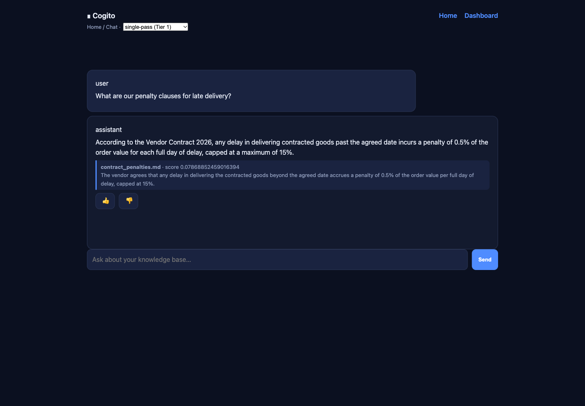
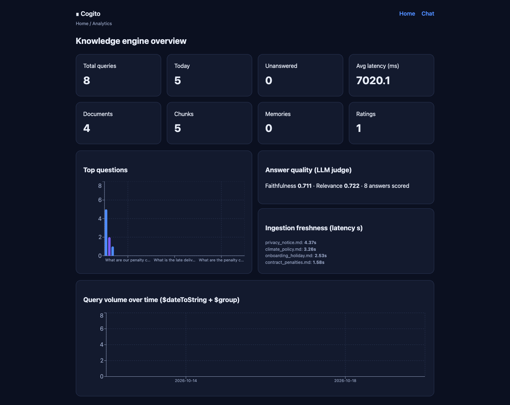

# Cogito: A MongoDB-Based Document Assistant with Hybrid Search and Cited Answers

**Course project report**
**Subject:** NoSQL databases
**Submitted by:**

| S. No. | Name | Roll number |
|---|---|---|
| 1 | Pranesh Nikhar | 2427010267 |
| 2 | Soumyajit Chatterjee | 2427010255 |
| 3 | Anmol Kaushik | 2427010576 |
| 4 | Ojas Khandelwal | 2427010381 |

**Date:** October 2026

---

## Abstract

Cogito is a document assistant built on MongoDB. Documents index themselves through a change stream, questions are answered with hybrid retrieval that fuses keyword search and vector search, and every answer cites the passages it used. The project demonstrates the database features that make this possible without extra infrastructure: change streams, multi-document transactions, `$search`, `$vectorSearch`, `$rankFusion`, and aggregation pipelines for analytics. A retrieval-augmented generation pipeline (chunking, embeddings, reranking, cited answers, LLM-judged evaluation, a feedback loop, an agent loop, and long-term memory) runs on top of the same deployment. The system is exposed through a REST API, a web dashboard, and an MCP server, and it runs either fully offline or with OpenAI, Gemini, OpenRouter, or Ollama as the model provider.

---

## 1. Introduction

Cogito is a web application that stores documents and answers questions about their content. A user uploads a file, which can be a PDF, a text file, a contract, or a web page. The system extracts the text, splits it into passages, and stores each passage together with a numeric vector that represents its meaning. When a user asks a question in plain English, the system retrieves the most relevant passages and produces an answer that cites them.

The project started from one question: how much of a modern document-processing system can live inside a single database? MongoDB stores the documents and their vectors, runs the keyword search, runs the semantic search, computes the dashboard analytics, and triggers the indexing work when a new document arrives. There is no separate vector database and no separate search engine to keep in sync.

[FILL IN - your own words: two or three sentences about why you chose this topic. For example: what you were curious about, whether you had used any retrieval or AI tool before, and what you hoped to learn about document databases. Do not repeat the sentences above.]

---

## 2. System overview

The application has four main behaviours.

1. **Automatic indexing.** Inserting a document marks it as `pending`. A background worker picks it up, extracts the text, splits it, embeds each part, and stores the chunks. The worker listens to a change stream, so nothing has to be scheduled or re-run by hand.
2. **Hybrid retrieval.** A question matches stored passages in two ways, by exact words and by meaning. The two ranked lists are merged into one ranking with Reciprocal Rank Fusion [4][9].
3. **Cited answers.** A language model receives the retrieved passages with a strict instruction: every claim must trace back to a passage, and the response must list its citations. If no model provider is configured, a built-in local generator produces the same response shape, so the whole pipeline still runs offline.
4. **Three interfaces.** The same assistant is reachable through a REST API (FastAPI), a web dashboard (Next.js), and a Model Context Protocol (MCP) server [12], which lets AI clients such as Claude Desktop or Cursor query the knowledge base as a tool.

The screenshot below shows the web chat answering a question with a grounded, cited response.

{ width=6.2in }

### 2.1 API surface

The backend exposes the following HTTP routes (admin routes require the `X-Admin-Token` header):

| Method and path | Purpose |
|---|---|
| `GET /health`, `GET /capabilities` | service health and the active search/LLM mode |
| `POST /ingest`, `POST /ingest/raw` | add a document (file upload or raw text) |
| `GET /ingest/documents` | list ingested documents and their status |
| `POST /search`, `POST /search/multi` | ranked passages, single or multi-query |
| `POST /ask`, `POST /ask/multi`, `POST /ask/agent` | grounded answers, direct or through the agent loop |
| `POST /chat`, `GET /chat/conversations` | chat with history and memory recall |
| `POST /memories`, `GET /memories`, `POST /memories/recall` | long-term facts |
| `POST /feedback` | thumbs up or down on an answer |
| `GET /eval` | LLM-judge scores per answer |
| `GET /analytics/overview`, `/histogram`, `/queries`, `/unanswered`, `/freshness` | dashboard aggregations |
| `POST /webhooks/ingest`, `POST /analytics/rollup` | automation and reporting hooks |

---

## 3. Data model

The system uses seven collections in one MongoDB database.

| Collection | Purpose | Key fields |
|---|---|---|
| `documents` | source files and metadata | `_id`, `path`, `title`, `type`, `hash`, `status`, `raw`, `summary`, `keywords`, `chunk_count` |
| `chunks` | text passages and vectors | `_id`, `document_id`, `text`, `embedding`, `page`, `order`, `token_count`, `title`, `boost` |
| `conversations` | chat history | `_id`, `user_id`, `messages[]`, `created_at` |
| `memories` | long-term facts | `_id`, `user_id`, `fact`, `embedding`, `importance`, `updated_at` |
| `query_logs` | one record per question | `_id`, `question`, `chunks_returned`, `chunk_ids[]`, `latency_ms`, `answer_id`, `ts` |
| `eval_results` | judge scores | `_id`, `answer_id`, `faithfulness`, `relevance`, `judge`, `ts` |
| `feedback` | user ratings | `_id`, `answer_id`, `rating`, `comment`, `ts` |

### 3.1 The unit of storage

The key design decision is the unit of storage. The natural unit of work in a retrieval system is a chunk: a passage, its vector, and its metadata. In a relational schema those would be a row, another row (or a large column), and a join across tables. Here they form one JSON document, which is exactly the shape the retrieval code needs to read [15]. A stored chunk looks like this:

```json
{
  "_id": "c392cfe9-...",
  "document_id": "82f9cb6d-...",
  "text": "4.1 Late Delivery. The vendor agrees that any delay ...",
  "embedding": [0.013, -0.041, 0.008, "..."],
  "page": 1,
  "order": 3,
  "token_count": 141,
  "title": "contract_penalties.md",
  "mime": "text/markdown",
  "boost": 1.0,
  "created_at": 1792312802.17
}
```

### 3.2 Flexible schema in practice

Optional fields appear only when they are relevant. A chunk carries `page` only for paginated formats, `summary` and `keywords` appear on a document only after enrichment, and `boost` starts at `1.0` and changes when users rate answers. A relational schema would need nullable columns or extra tables for each of these cases. The raw file bytes are also stored in the document record as BSON binary, so the ingestion worker can read the content directly from the change event without a separate file store.

### 3.3 Indexes

| Index | Field | Used for |
|---|---|---|
| Text index | `chunks.text` | lexical search in fallback mode (`$text`) |
| Search index | `chunks.text` (MongoDB Search) | lexical search in full mode (`$search`) |
| Vector index | `chunks.embedding`, HNSW, cosine, scalar quantization | semantic search (`$vectorSearch`) |
| Single field | `documents.status` | finding pending documents |
| Single field | `chunks.document_id` | fetching the chunks of one document |
| Compound | `documents` on (`path`, `hash`) | duplicate detection at ingest |
| Compound | `memories` on (`user_id`, `updated_at`) | per-user recall, newest first |
| Single field | `query_logs.ts` | analytics over time |

---

## 4. Automatic indexing with change streams

Change streams are the feature that shaped the whole design [1]. A change stream is a database cursor that emits events whenever documents change. The worker opens a stream on the `documents` collection and waits. When a document with status `pending` appears, the worker extracts the text, chunks it, embeds each chunk, stores everything, and flips the status to `indexed`.

The full sequence for one upload is:

1. `POST /ingest` writes the document with `status: "pending"` and the raw bytes.
2. The change stream fires an insert event (with `full_document: "updateLookup"`).
3. The worker extracts text (`pypdf`, `python-docx`, or plain decode depending on the file type).
4. The text is split into overlapping passages with a recursive splitter.
5. Each passage is embedded by the configured provider (Gemini, OpenAI, OpenRouter, Ollama, or the built-in local embedder).
6. The chunks are written and the document is flipped to `indexed` inside one transaction.

Two details matter for reliability. First, the worker stores the stream's resume token in Redis after each event, so a restart resumes from the last processed event instead of losing whatever arrived in between. Second, on startup the worker backfills any documents still marked `pending`, which covers the case where the API accepted a document while the worker was down.

We measured the drop-to-indexed latency in the analytics endpoint. With the local embedder, a document became queryable about 0.26 seconds after insertion, and about 6 milliseconds when models were warm. With the Gemini embedding API the same step takes 1.6 to 4.4 seconds per document, which is the network round-trip to the provider and is visible in the dashboard's freshness panel.

---

## 5. Hybrid retrieval

Retrieval combines two different signals. Keyword search matches literal words and clause numbers. Semantic search matches meaning, so a question about "late delivery fees" can match a passage titled "vendor obligations". Each signal alone has a known failure mode: keyword search misses paraphrase, and vector search is unreliable on exact identifiers.

### 5.1 The two modes

| Condition | Path | Operators |
|---|---|---|
| MongoDB Search (mongot) available | `_full_hybrid` | `$search` + `$vectorSearch` combined by `$rankFusion` |
| Plain `mongod` (no search engine) | `_fallback_hybrid` | `$text` + cosine similarity combined by an in-code RRF |

Both paths return the same fields (`_id`, `text`, `document_id`, `title`, `page`, `score`), so the rest of the system does not know which one ran. A startup probe decides the mode, and the result is cached in `db.search_mode_sync()` for the hot path.

### 5.2 The native pipeline

In full mode the whole retrieval is a single aggregation. This is the pipeline the code sends (simplified):

```javascript
[
  { $rankFusion: {
      input: {
        pipelines: {
          search: [ { $search: { index: "cogito_text",
                                 text: { query: question, path: "text" } } } ],
          vector: [ { $vectorSearch: { index: "cogito_vector",
                                       path: "embedding",
                                       queryVector: queryEmbedding,
                                       numCandidates: 100,
                                       limit: 100 } } ]
        }
      }
  } },
  { $limit: k },
  { $project: { _id: 1, text: 1, document_id: 1, title: 1, page: 1,
                score: { $meta: "score" } } }
]
```

`$rankFusion` executes both pipelines, de-duplicates the results, and scores every document with the Reciprocal Rank Fusion formula, where each pipeline contributes a weighted `1/(60 + rank)` term. The constant 60 is chosen by MongoDB [4]; the technique itself comes from Cormack et al. [9]. The fused score is surfaced through the `$meta: "score"` expression, which took one debugging round to get right (section 11, problem 3).

### 5.3 The fallback pipeline

When MongoDB Search is not available, the lexical branch runs against a `$text` index and the semantic branch computes cosine similarity in Python over the stored vectors. The two lists are then fused by `_rrf_fuse`, which implements the same reciprocal rank formula in about ten lines. This is slower than the native path on large collections, but it produces the same ranking behaviour and keeps every deployment usable.

The search retrieves 5 chunks by default, while the vector branch considers 100 candidates. That over-request ratio follows the guidance in the `$vectorSearch` documentation, which recommends requesting at least 20 times the result limit so the fused ranking has enough material [3].

### 5.4 Reranking and query expansion

Retrieved candidates pass through a reranker. When the `sentence-transformers` library is installed, a cross-encoder model (`ms-marco-MiniLM-L-6-v2` [11]) re-scores every candidate against the question; without it, a lighter lexical boost promotes chunks that share distinctive terms with the question. Multi-query search expands the question into several rewritings, retrieves for each, and fuses the results; offline it uses a deterministic keyword expansion, and with a model key it asks the model for real rewritings.

---

## 6. Analytics with aggregation pipelines

The dashboard is computed entirely with aggregation pipelines over `query_logs`, `eval_results`, and `feedback`. The overview endpoint runs one `$facet` pass that computes several metrics at once:

```javascript
{ $facet: {
    totals:     [ { $count: "n" } ],
    unanswered: [ { $match: { chunks_returned: 0 } }, { $count: "n" } ],
    latency:    [ { $group: { _id: null,
                              avg: { $avg: "$latency_ms" },
                              max: { $max: "$latency_ms" } } } ],
    by_day:     [ { $group: { _id: { $dateToString: {
                              format: "%Y-%m-%d",
                              date: { $toDate: { $multiply: ["$ts", 1000] } } } },
                              count: { $sum: 1 } } },
                  { $sort: { _id: 1 } } ]
} }
```

The other dashboard panels use `$bucketAuto` (an eight-bucket latency histogram) and `$group` with `$sort` and `$limit` (the most frequent questions). `$facet` is worth noting because it returns each sub-pipeline as an array, a detail that produced a real bug during development (section 11, problem 1).

{ width=6.2in }

The screenshot above shows the dashboard after four documents were ingested and several questions were asked: totals per collection, the average end-to-end latency with the Gemini provider (7,423 ms per answer, dominated by the two model calls), the ingestion freshness per document, the LLM-judge scores (faithfulness and relevance), and the two charts.

---

## 7. Transactions, atomicity, and the replica set

Re-indexing a document replaces its chunks. If the delete succeeded and the insert failed, the document would look indexed while its content was missing. The ingestion function therefore performs the delete, the insert, and the status update inside one multi-document transaction [6]:

```python
async with await client.start_session() as session, session.start_transaction():
    await chunks.delete_many({"document_id": doc_id}, session=session)
    if to_insert:
        await chunks.insert_many(to_insert, session=session)
    await documents.update_one({"_id": doc_id}, status_update, session=session)
```

Writing the `await` correctly took two attempts. The first version omitted it, the transaction never actually started, and the code silently used the three-write fallback; section 11 explains how the mistake was found.

Change streams and transactions both require a replica set [8]. The Docker setup promotes a single node into a one-member replica set (`rs0`) during bootstrap, so both features work with one container and no extra machine.

---

## 8. The AI components

AI appears at several stages of the pipeline. Every stage is pluggable: it runs fully offline with built-in local models, and upgrades automatically when a provider key is configured.

### 8.1 Embeddings

The first AI step converts text into vectors. The project implements five embedding providers behind one interface:

| Provider | Model (default) | Dimension | Key needed |
|---|---|---|---|
| Local (built-in) | hashed word n-grams | 384 | no |
| Gemini | `gemini-embedding-001` | 3072, stored at 768 | yes |
| OpenAI | `text-embedding-3-small` | 1536, stored at `EMBEDDING_DIM` | yes |
| OpenRouter | any served embedding model | as configured | yes |
| Ollama | `nomic-embed-text` | as configured | local server |

The local embedder hashes word unigrams and trigrams into a fixed-size vector and normalizes it, which keeps the pipeline runnable with no accounts. Every provider's output passes through `fit()`, which trims or pads the vector to `EMBEDDING_DIM` and re-normalizes it. For Gemini this matters: the model returns 3072 dimensions by default, the project stores 768 (a recommended size for this model), and `fit()` performs exactly the truncation and renormalization the documentation requires for that case. The query path applies the same normalization, without which the query vector and the index dimensions disagree; that mismatch was one of the bugs found during development.

### 8.2 Chunking

Documents are split with a recursive character splitter with overlap. The parameters are:

| Parameter | Value |
|---|---|
| Chunk size | 800 characters (500 for contract documents) |
| Overlap | 120 characters |
| Separators | paragraph, line, sentence, semicolon, word, character |

PDF extraction inserts a page marker between pages, so a citation can point at a page number. The extractor also handles DOCX, HTML, CSV, JSON, plain text, and images through OCR when Tesseract is available.

### 8.3 Document enrichment

On ingestion, each document gets a summary and a list of keywords, stored on the document record. Offline, an extractive summarizer scores sentences by the frequency of their non-stop words and returns the top sentences. With a model key, the LLM writes an abstractive summary instead. This makes the knowledge base navigable without opening every source file.

### 8.4 Grounded answers

The retrieved chunks are sent to the model with a system prompt that requires a JSON response with the answer and its citations, and that instructs the model to say so when the context does not contain the answer [10]. The expected contract is:

```json
{
  "answer": "Under Section 4.1, late delivery accrues a 0.5% penalty per day, capped at 15%.",
  "citations": [
    { "document_id": "82f9cb6d-...", "title": "contract_penalties.md",
      "excerpt": "4.1 Late Delivery. The vendor agrees ...", "score": 0.079 }
  ]
}
```

Provider calls run through a single background event loop. The API handlers and the ingest worker are asyncio-based, so a blocking provider call would stall the server; routing every call to one long-lived loop thread gave a synchronous facade without that problem. This design is shared by OpenRouter, OpenAI, Gemini, and Ollama.

### 8.5 Evaluation

Every answer is scored on two axes. Faithfulness asks whether each claim is supported by a retrieved chunk (a hallucination guard). Relevance asks whether the answer actually addresses the question. With a model configured, the model is the judge; offline, a deterministic heuristic compares the answer's terms against the question and the context. Scores are stored in `eval_results` and charted on the dashboard, so a change in retrieval or prompt quality is visible over time.

### 8.6 Feedback loop

When a user rates an answer thumbs up or thumbs down, the chunks that produced it receive a boost adjustment: `+0.5` for a helpful rating and `-0.25` for a poor one, clamped between `0.25` and `4.0`. Retrieval applies the multiplier to the fusion score before reranking, so the ranking changes as ratings accumulate. This is the simplest possible learning-to-rank loop, and it is fully inspectable: the boost is a plain field on the chunk.

### 8.7 Agent loop and long-term memory

The agent endpoint runs a LangGraph `StateGraph` [13] with three nodes:

1. **retrieve**: run hybrid search with a larger budget (40 candidates).
2. **should_refine**: compute confidence as the average score of the top three chunks. If confidence is below the threshold and fewer chunks came back than the top-k setting, refine the query by adding distinctive terms from the best chunk and retrieve again, bounded by `AGENT_MAX_ITERATIONS` (3).
3. **generate**: produce the grounded, cited answer.

The memory feature stores extracted facts in the `memories` collection with their embeddings. Recall embeds the query and computes cosine similarity against a user's memories, returning the closest few, which are injected into later prompts. This is the "agent memory" pattern implemented directly on the same database.

---

## 9. Testing and verification

The repository includes automated tests and a small CI pipeline.

| Area | What is tested |
|---|---|
| Chunking | overlap behaviour, stable content hashes, page tracking for PDFs |
| Embeddings | local embedder dimension and normalization, `fit()` behaviour, output dimension of the public API |
| Providers | Gemini provider wiring through the factories |
| Concurrency | the sync-over-async runner from inside and outside a running event loop |
| Local LLM | cited answer shape, empty-context behaviour |
| Evaluation | heuristic judge ranges |
| Retrieval | lexical rerank promotes the passage containing the query terms |
| Expansion | deterministic multi-query expansion produces unique variants |
| Extraction | HTML and DOCX parsing, graceful degradation on unknown binary input |

The commands are:

```bash
cd src/backend
pip install -e ".[dev]"
pytest tests/ -q        # 17 tests
ruff check app          # linter
```

In addition to the unit tests, `tests/test_mcp_client.py` is a standalone smoke script that starts the MCP server over stdio and calls its tools, and `scripts/seed.py` inserts four sample documents for a manual run. Continuous integration runs the linter and the test suite on every push.

---

## 10. Results

The system was verified end to end on 18 October 2026, running the Docker stack on a laptop with the Gemini provider configured for both chat and embeddings.

| Measurement | Result |
|---|---|
| Automated tests | 17 passing, linter clean |
| Ingestion, local embedder | 0.26 s first run, 6 ms warm |
| Ingestion, Gemini embeddings | 1.6 to 4.4 s per document (network bound) |
| Answer latency, Gemini chat and judge | about 7.4 s average end to end |
| Retrieval | hybrid mode active (`$search` + `$vectorSearch` + `$rankFusion`) |
| Answer quality | faithfulness and relevance scored per answer by the LLM judge |
| Interfaces | REST API, dashboard, and 7 MCP tools verified |

Both screenshots in this report were captured from the running system: the chat interface answering a question about the penalty clauses (Figure 1) and the dashboard after ingestion (Figure 2). The dashboard numbers correspond to the four seeded documents (climate policy, privacy notice, onboarding holiday policy, and vendor contract), five chunks, and the questions asked during verification.

With the offline providers the same pipeline runs with template answers and hashed embeddings; a provider key changes answer quality, not the structure of the system.

---

## 11. Problems and how they were fixed

1. **The analytics endpoint crashed as soon as real data existed.** `$facet` returns each sub-pipeline's output as an array, and the code treated the result as a single object. The endpoint returned 500 only after `query_logs` had rows, which made the cause non-obvious. The fix unwraps the first element of each array.

2. **Re-indexing never used a transaction.** Motor returns a future from `client.start_session()`. The first version used it directly in an `async with`, so the transaction never started and the code fell through to the three-write fallback without raising anything. The fix was one missing `await`.

3. **The fused score was missing from results.** `$rankFusion` attaches its score in a metadata field, and the projection read the wrong path, so every result carried a zero score. Projecting with `{"$meta": "score"}` fixed it.

4. **The evaluation endpoint returned a serialization error.** MongoDB identifiers are `ObjectId` objects and are not JSON serializable, so `GET /eval` failed as soon as it returned stored documents. The response now converts identifiers to strings.

5. **The MCP smoke test failed.** The MCP SDK's stdio client forwards only a whitelist of environment variables to the server process, so the MongoDB URI never arrived and the server could not connect. The test now passes its environment explicitly.

A sixth issue appeared during the final provider switch and is worth mentioning because it combined three causes: the containers were still running an image built before the new provider code existed, the old worker consumed the change stream during the container swap and re-embedded documents with the previous provider, and, once the new code was live, the query path sent 3072-dimension vectors to an index built for 768. The first two were deployment sequencing; the third was a genuine code gap and now has a unit test.

[FILL IN - your own words: pick two of the problems above and describe what you observed first, what you suspected, and how you confirmed the fix. Two or three sentences each.]

---

## 12. Limitations and future work

- Authentication is a single shared admin token for write routes. The data model already carries `user_id` fields, but there is no real login or per-user isolation yet.
- Offline mode answers with a template generator and hashed embeddings. It demonstrates the pipeline; meaningful answer quality needs an API key.
- The reranker is optional because `sentence-transformers` is not a required dependency, and the lexical fallback is weaker than the cross-encoder.
- The deployment is a single MongoDB container intended for a demonstration. A production system would separate services and size the cluster properly.
- The MCP integration is outbound only. A next step would be connecting to MongoDB's official MCP server so the agent can compose its own aggregations instead of calling fixed tools.

[FILL IN - optional: one improvement you would implement first, and why.]

---

## 13. Conclusion

Building Cogito showed us how much a document database can do when its features are used together. Change streams removed the need for an indexing pipeline, multi-document transactions made re-indexing safe, and the aggregation framework produced the dashboard without a separate reporting tool. Coming from a relational background, the clearest difference was the data model: treating a chunk, its vector, and its metadata as one document kept every stage of the pipeline simple, and the flexible schema let optional fields appear only when they were needed. The advice we would give another student is to test with real data from day one, because every serious bug we found, from the facet arrays to the dimension mismatch, only appeared once real documents and a real model provider were in place.

---

## References

[1] MongoDB. Change Streams. https://www.mongodb.com/docs/manual/changeStreams/

[2] MongoDB. `$search` aggregation stage (MongoDB Search). https://www.mongodb.com/docs/search/query/aggregation-stages/search/

[3] MongoDB. Run Vector Search ANN and ENN Queries (`$vectorSearch`). https://www.mongodb.com/docs/vector-search/query/aggregation-stages/vector-search-stage/

[4] MongoDB. `$rankFusion` aggregation stage. https://www.mongodb.com/docs/manual/reference/operator/aggregation/rankFusion/

[5] MongoDB. Aggregation Pipeline. https://www.mongodb.com/docs/manual/core/aggregation-pipeline/

[6] MongoDB. Transactions. https://www.mongodb.com/docs/manual/core/transactions/

[7] MongoDB. Indexes. https://www.mongodb.com/docs/manual/indexes/

[8] MongoDB. Replication. https://www.mongodb.com/docs/manual/replication/

[9] G. V. Cormack, C. L. A. Clarke, and S. Buettcher. Reciprocal Rank Fusion Outperforms Condorcet and Individual Rank Learning Methods. SIGIR 2009. https://plg.uwaterloo.ca/~gvcormac/cormacksigir09-rrf.pdf

[10] P. Lewis et al. Retrieval-Augmented Generation for Knowledge-Intensive NLP Tasks. NeurIPS 2020. https://arxiv.org/abs/2005.11401

[11] Sentence-Transformers. cross-encoder/ms-marco-MiniLM-L-6-v2 model card. https://huggingface.co/cross-encoder/ms-marco-MiniLM-L-6-v2

[12] Model Context Protocol. Specification and documentation. https://modelcontextprotocol.io/

[13] LangChain. LangGraph overview. https://docs.langchain.com/oss/python/langgraph/overview

[14] Google. Gemini API OpenAI compatibility. https://ai.google.dev/gemini-api/docs/openai

[15] MongoDB. Data Modeling. https://www.mongodb.com/docs/manual/data-modeling/

---

## Appendix A: Running the project

```bash
# 1. start the stack (MongoDB with Search, backend, worker, Redis, Postgres)
cp .env.example .env
docker compose up -d --build

# 2. seed four sample documents (the change stream indexes them)
docker exec cogito-backend python -m app.scripts.seed

# 3. ask a question
curl -s -XPOST localhost:8000/ask -H 'Content-Type: application/json' \
  -d '{"question":"What are the penalty clauses for late delivery?"}'

# 4. web interfaces
open http://localhost:8000/docs      # API documentation
open http://localhost:3000/chat      # chat
open http://localhost:3000/dashboard # analytics
```

## Appendix B: Repository structure

```
Cogito/
├── docker-compose.yml            full local stack
├── docker/                       replica-set bootstrap and Postgres schema
├── src/backend/
│   ├── app/                      FastAPI app, ingestion worker, core modules
│   │   ├── core/                 retrieval, llm, agent, evaluator, memory, feedback
│   │   ├── routers/              ingest, search, chat, memory, analytics, health
│   │   └── scripts/              ensure_indexes, seed
│   └── tests/                    unit tests and the MCP smoke script
├── src/mcp_cogito/server.py      MCP tools
├── web/                          Next.js chat page and dashboard
└── docs/                         proposal, report, feature map
```
