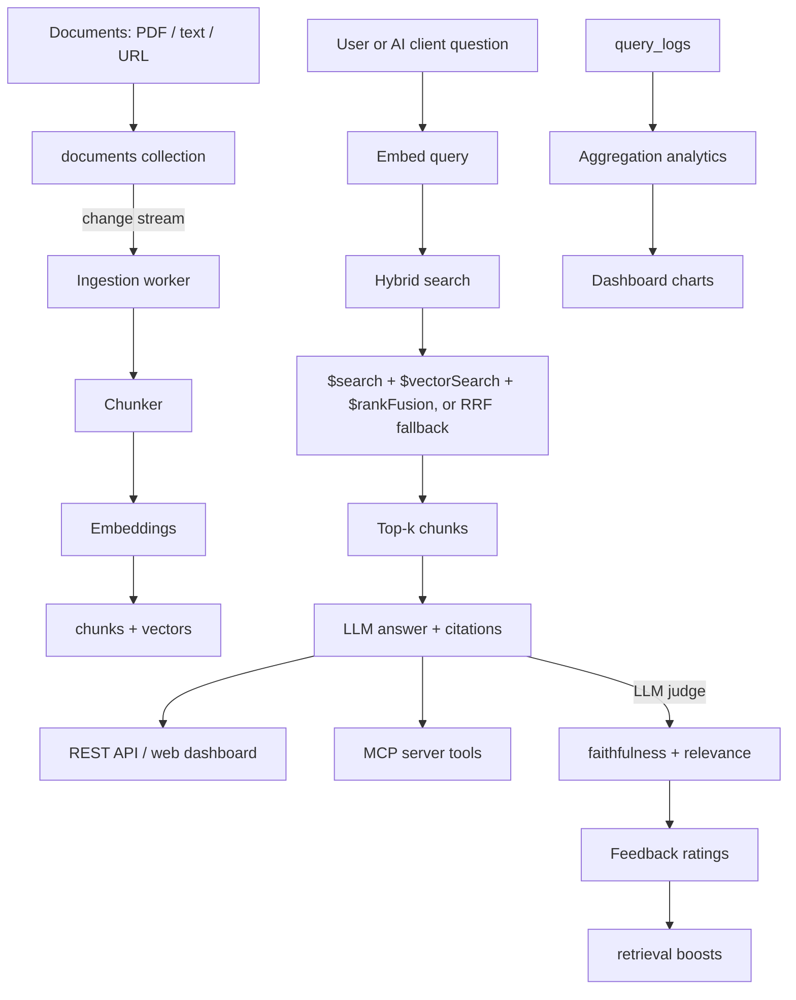

# Cogito

## A MongoDB-native document assistant with hybrid search, cited answers, and MCP access

Prepared August 2026. This document is the plan of record for the project and
describes the intended scope, design, and milestones.

---

## 1. Summary

Cogito keeps a small knowledge base of documents and answers questions about
them. A file that is added to the system indexes itself: the text is split into
passages, each passage is embedded, and everything is stored in MongoDB. A
question is answered by retrieving the most relevant passages and generating a
reply with citations, and the same assistant is exposed to AI clients through
the Model Context Protocol (MCP).

The name comes from the Latin *cogito* ("I think"). The goal behind it is
modest but concrete: a system that stores knowledge and also reasons over it,
without pulling in a separate vector store or search engine.

---

## 2. Problem

Working with a folder of documents is harder than it should be, for three
common reasons.

1. Keyword search fails on paraphrase. A question about "late delivery
   penalties" misses a section titled "vendor obligations", even though any
   reader would say the two are related.
2. Indexing is manual. Most small RAG setups need a script or a scheduled job
   to pick up new files, and anything that is not re-run leaves the index
   silently stale.
3. The knowledge is trapped in one application. A chat page nobody opens adds
   little; people already work inside an AI assistant or an editor.

The project takes one of these at a time: semantic retrieval for paraphrase,
change streams for indexing, and MCP for reach.

---

## 3. Intended behaviour

The plan describes the following user flow.

1. A document is added through the API, a watched folder, or the MCP tool
   `add_document`.
2. The insert triggers a change stream event. A worker chunks, embeds, and
   stores the document without any manual step, and writes a summary and
   keywords onto the record.
3. The user asks a question, for example: "What are the penalty clauses for
   late delivery?"
4. Retrieval runs two searches at once. One matches words, one matches meaning,
   and the two rankings are fused into a single list.
5. A language model writes an answer that cites the passages it used, and a
   second model call grades the answer for grounding and relevance.
6. A rating from the user adjusts how the cited passages are ranked in future
   searches.
7. The same question can be asked from the web page, the REST API, or an AI
   client connected over MCP.

---

## 4. Scope

Work is organised in three tiers. Tier 1 and Tier 2 are the required core;
Tier 3 items are attempted in order and dropped if time runs out.

### Tier 1, core retrieval

- Automatic ingestion through change streams (no cron, no manual re-index).
- Chunking with overlap, tuned per document type.
- Pluggable embeddings (OpenAI, Gemini, OpenRouter, Ollama, plus a key-free
  local embedder so the project runs offline).
- Hybrid search: `$search` and `$vectorSearch` fused with `$rankFusion` when
  MongoDB Search is available, and a `$text` + cosine + in-code RRF fallback
  when it is not.
- Answers with mandatory citations.

### Tier 2, MCP

- An MCP server exposing the assistant as tools, so any MCP client (Claude
  Desktop, Cursor, Gemini CLI, Codex) can use the knowledge base.

### Tier 3, advanced

- Reranking: an optional cross-encoder pass over the retrieved candidates,
  with a lexical fallback when the model is not installed.
- Agent loop on LangGraph: retrieve, check confidence, refine and re-retrieve
  when weak, then answer.
- Long-term memory: facts stored with embeddings and recalled by similarity.
- Evaluation: an LLM judge scoring faithfulness and relevance for every answer,
  stored over time.
- Feedback loop: ratings adjust retrieval ranking.
- Multimodal ingest: PDFs with images and DOCX/HTML files, with OCR when
  available.
- Analytics dashboard computed with aggregation pipelines over the query log.

Deliberately out of budget: real user accounts, multi-tenant isolation, and
fine-tuning of any model. These are listed under future work in section 12.

---

## 5. Architecture

Everything lives in one MongoDB deployment: documents, chunk vectors,
conversations, memory, logs, evaluation scores, and ratings. The write path
(ingestion) and the read path (questions) meet only in the database.

---

## 6. Data model

| Collection | Purpose | Key fields |
|---|---|---|
| `documents` | source files and metadata | `_id`, `path`, `title`, `type`, `hash`, `status`, `summary`, `keywords` |
| `chunks` | passages and vectors | `_id`, `document_id`, `text`, `embedding`, `page`, `order`, `token_count`, `boost` |
| `conversations` | chat history | `_id`, `user_id`, `messages[]` |
| `memories` | long-term facts | `_id`, `user_id`, `fact`, `embedding`, `importance` |
| `query_logs` | one record per question | `_id`, `question`, `chunks_returned`, `chunk_ids[]`, `latency_ms`, `answer_id`, `ts` |
| `eval_results` | judge scores | `_id`, `answer_id`, `faithfulness`, `relevance`, `judge`, `ts` |
| `feedback` | user ratings | `_id`, `answer_id`, `rating`, `comment`, `ts` |

Indexes planned for the first milestone: a text index on `chunks.text`, an HNSW
vector index on `chunks.embedding`, lookups on `documents.status` and
`chunks.document_id`, and compound indexes for duplicate detection
(`documents.path` + `hash`) and per-user memory reads.

---

## 7. Retrieval design

A retrieval call runs one aggregation with two entry points. The lexical branch
uses `$search` over a text index, and the semantic branch uses `$vectorSearch`
over the vector index. `$rankFusion` executes both and merges them with
Reciprocal Rank Fusion, returning a single ranked set with a score per document.

The fallback path exists because MongoDB Search is not available in every
deployment. In that mode the lexical branch uses a `$text` index and the
semantic branch computes cosine similarity in Python. The fusion step is
implemented directly (the same `1/(60 + rank)` formula) so both paths return
identical result fields. A startup probe decides which path is active, and the
two are interchangeable from the rest of the code's point of view.

The over-request ratio (100 vector candidates for 5 returned results) follows
the guidance in the `$vectorSearch` documentation.

---

## 8. MCP surface

The server exposes seven tools:

| Tool | Input | Output |
|---|---|---|
| `list_sources` | none | indexed documents with summary and keywords |
| `search_knowledge` | query, k | ranked passages |
| `search_multi` | query, k | ranked passages from expanded queries |
| `ask_question` | question | answer with citations and scores |
| `add_document` | path | indexing result |
| `remember` | fact | stored memory id |
| `recall` | query, limit | relevant memories |

The server runs over stdio, so a client registers it with a short JSON
configuration block and gains the tools without any change to the client.

---

## 9. Technology choices

| Layer | Choice | Reason |
|---|---|---|
| Database | MongoDB 8.2 with MongoDB Search, via the `mongodb-atlas-local` Docker image | one process provides the database, the search engine, and change streams |
| Backend | Python, FastAPI, Motor (async driver) | async I/O matches the change-stream worker and the API |
| Chunking | LangChain recursive text splitter | standard, well-tested splitter with overlap support |
| Embeddings and LLM | OpenAI, Gemini, OpenRouter, Ollama, and a built-in local mode | the project must run with zero keys and upgrade with a key |
| Agent loop | LangGraph | small state graphs without a large framework |
| MCP | MCP Python SDK | the reference SDK for stdio servers |
| Web | Next.js with Recharts | two small pages (chat, dashboard), easy deployment |
| Supporting services | Redis, Postgres, n8n (optional), PostHog and Sentry SDKs (no-op without keys) | caching, analytics mirror, and scheduled automations |

---

## 10. Cost

The project is designed to run at zero cost.

- Self-hosted: the Docker image bundles the database and the search engine on
  one machine, so the full feature set works without an account.
- Managed alternative: a free Atlas tier works for storage and vector search,
  while `$search` requires a paid tier. The fallback path covers this case.
- Model providers: the local embedder and template answer generator need no
  key; any paid provider is swapped in through environment variables.

---

## 11. Milestones

| Milestone | Deliverable | Estimated effort |
|---|---|---|
| M1 | MongoDB 8.2 replica set running; driver connected | 0.5 day |
| M2 | Change-stream ingestion: chunk, embed, store, index | 2 days |
| M3 | Hybrid retrieval and cited answers (Tier 1) | 2 days |
| M4 | MCP server tested against a real client (Tier 2) | 2 days |
| M5 | Agent loop and memory | 2 days |
| M6 | Evaluation and feedback loop | 1.5 days |
| M7 | Analytics dashboard | 1.5 days |
| M8 | Reranking, multimodal ingest, polish | 2 days |

Success criteria for the finished project:

- A document is queryable a few seconds after insertion, with no manual step.
- A question returns an answer in which every claim cites a passage.
- Both retrieval paths (native fusion and fallback) produce results in the
  same format.
- The dashboard reports latency, unanswered questions, and judge scores from
  live data.
- An MCP client can call the tools and receive a cited answer.

---

## 12. Risks, and future work

| Risk | Mitigation |
|---|---|
| Retrieval quality | tune chunk size and overlap; keep reranking optional |
| Model hallucination | the citation requirement plus faithfulness scoring on every answer |
| Provider cost or outage | pluggable providers and a fully offline mode |
| Search engine missing in some deployments | startup probe and an equivalent fallback path |
| Worker restarts | resume tokens plus a pending-document backfill on startup |

Ideas that did not make the first scope: real user accounts and multi-tenant
scoping, an inbound connection to MongoDB's official MCP server so the agent
can compose its own aggregations, and larger multimodal coverage. These are
candidates for a second iteration, not promises.
